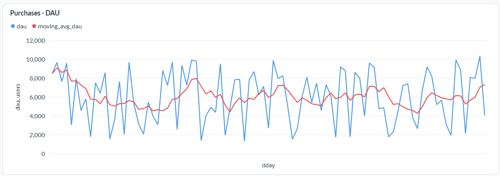
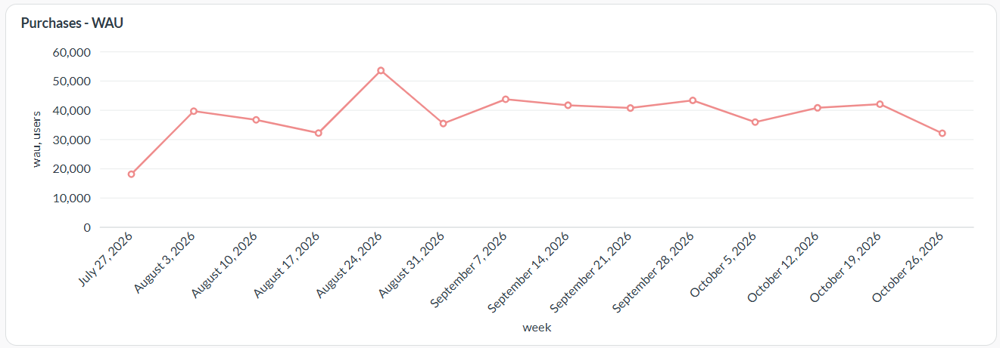
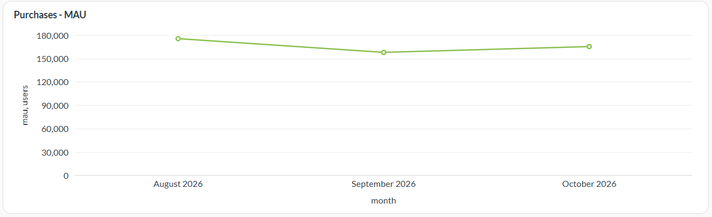
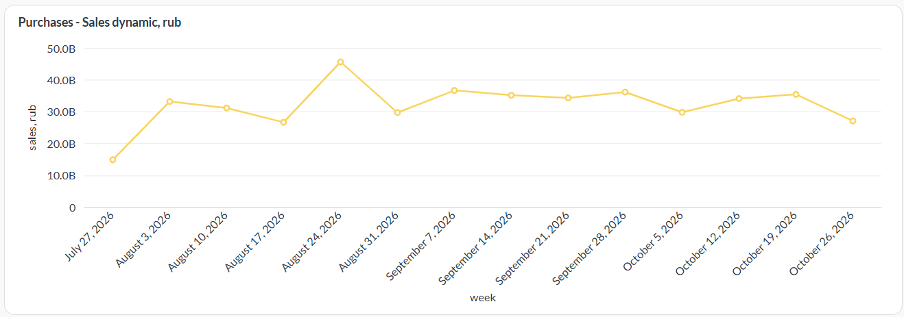
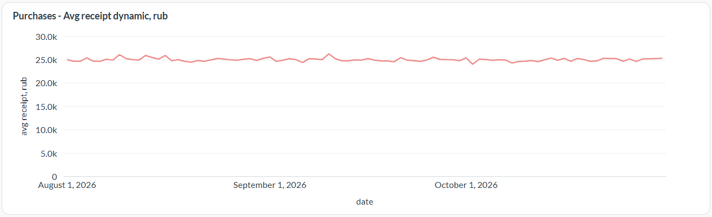
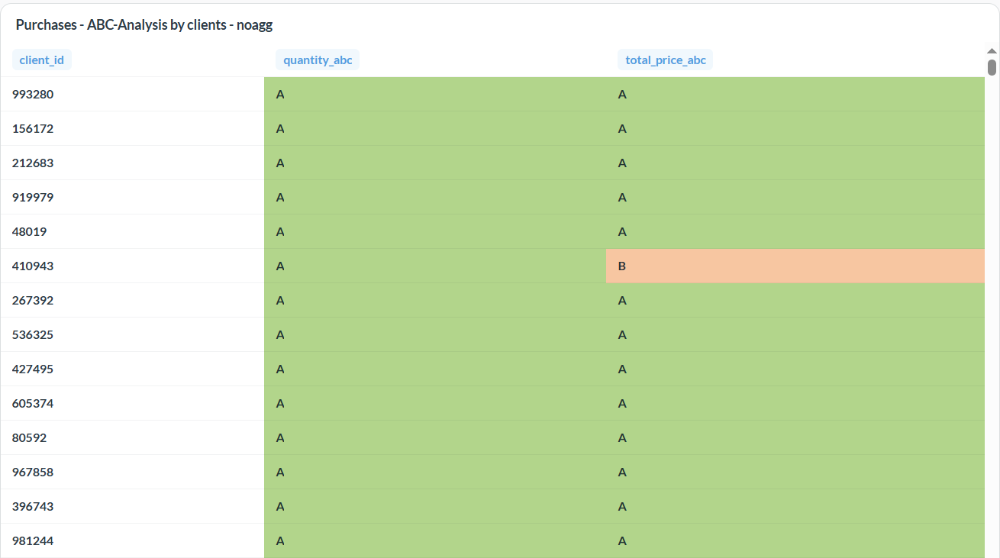
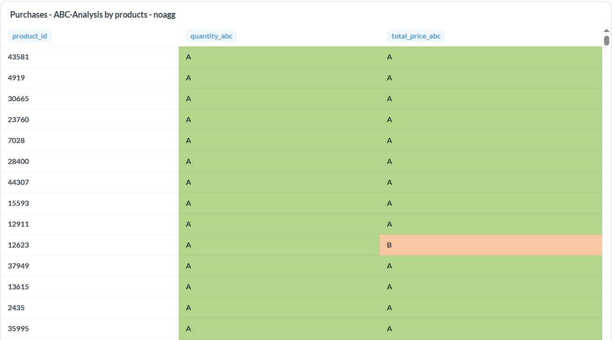

# ETL Pipeline | Online Store Purchases Data

## Цели и задачи проекта
Проект направлен на разработку и автоматизацию процессов выгрузки, обработки и загрузки данных по продажам крупного маркетплейса.
Скрипт запускается каждый день по расписанию в 07:00 утра, забирает данные по API за предыдущий день и загружает в БД PostgreSQL. На основе данных строится операционный дашборд, который позволит ослеживать динамику основных продуктовых метрик: DAU, MAU, WAU, ARPPU, Доходность.

## Структура Python-скрипта
1. Класс `PGConnection` для подключения к базе данных PostgreSQL. Экземпляр класса создавать не нужно. Класс содержит статический метод `get_pg_connection`.
2. Класс `ApiResponseReader` для получения данных по API. Нужно создать экземпляр класса с атрибутами `url` и `params` для доступа к API. Метод `get_response` получает ссылку на экземпляр класса и возвращает массив "сырых" данных.
3. Класс `ApiResponseProcessing` для обработки "сырых" данных. Нужно создать экземпляр класса с атрибутом `data` для хранения обработанных данных. Метод `pars_response` получает ссылку на экземпляр класса и массив необработанных данных, и возвращает массив данных в нужном формате.
4. Класс `ImportData` для загрузки данных в базу данных PostgreSQL. Экземпляр класса создавать не нужно. Класс содержит только один статический метод `import_data`.

## Запуск проекта
1. Сделать клон проекта.
2. Создать локальную базу данных в СУБД PostgreSQL.
3. Создать файл `config.ini` в корне проекта и прописать значения параметров без кавычек:
    - `DBNAME` = Название БД
    - `DBUSER` = Имя пользователя БД
    - `DBPASSWORD` = Пароль доступа к БД 
    - `DBHOST` = localhost. Если работаете с удаленной базой, то укажите адрес сервера БД
    - `DBPORT` = Порт для подключения к БД (в PostgreSQL по умолчанию 5432)
4. Установить зависимости из файла `requirements.txt`.
5. Запустить файл `etl_pipeline.py`.

## Автоматизация ETL
1. На reg.ru арендован виртуальный сервер (VPS) с Ubuntu
2. Установлены Python и pip
3. Склонирован и развернуть проект с кодом, установлены зависимости и виртуальное окружение
4. Установлена СУБД PostgreSQL
5. Развернута BI-система Metabase с использованием Docker
6. Настроен веб-сервер Nginx для доступа извне к Metabase
7. Настроен ежедневный запуск скрипта в 7:00 утра через crontab

## Примеры визуализаций

DAU - количество уникальных покупателей в день

Moving average dau - скользящее среднее значение DAU за 7 предыдущих дней включая текущий день

WAU - количество уникальных покупателей в неделю

MAU - количество уникальных покупателей в месяц

Sales dynamic, rub - доходность по неделям

Avg receipt dynamic, rub - динамика среднего среднего чека по неделям

ABC-анализ клиентов с сегментацией по количеству купленных товаров и доходности

ABC-анализ товаров с сегментацией по количеству купленных товаров и доходности

